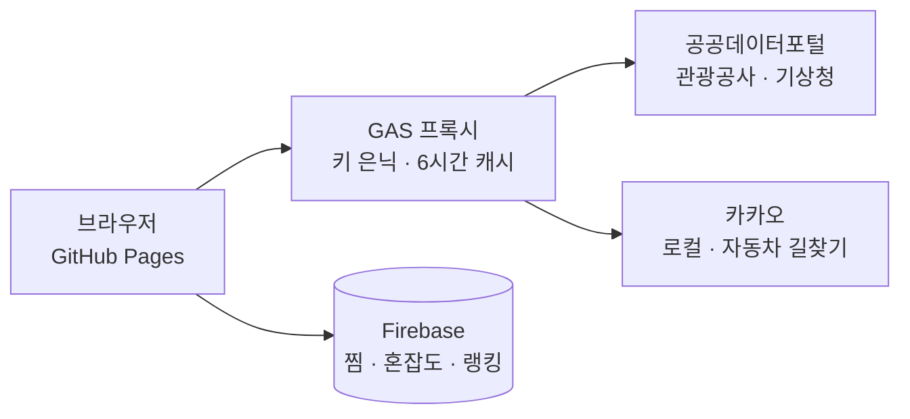

# 하루핏 (DayFit)

> 쓸 수 있는 시간에 맞춰, **현지에서 머물 수 있는 시간**으로 고르는 당일치기 여행 웹앱

- **배포 주소**: https://huiarchive.github.io/harufit/
- 모바일 프로그래밍 중간고사 대체 과제 (공공데이터포털 OpenAPI 활용 웹앱)

## 만든 이유

당일치기는 "어디가 좋은가"보다 "도착하면 몇 시간 있을 수 있는가"가 중요합니다.
예를 들어 8시간을 쓸 수 있어도 왕복 이동에 5시간 30분이 들면 현지에는 2시간 30분만 남습니다.
하루핏은 출발지와 쓸 수 있는 시간을 입력하면 **왕복 이동시간을 뺀 현지 체류 가능 시간**을 계산해 여행지를 보여 줍니다.
여기에 목적지 날씨, 사용자 혼잡도 제보, 여러 곳을 묶은 하루 코스까지 더해 하루 계획을 세울 수 있게 했습니다.

## 화면 구성 (HTML 5페이지)

| 화면 | 파일 | 설명 |
|---|---|---|
| 탐색 | `index.html` | 동네·주소·역 이름으로 출발지를 정하고, 4·6·8·10시간 중 선택하면 체류 시간이 긴 순서로 여행지를 보여 줍니다. 이동시간·날씨·실내/야외 필터, 마지막 검색 자동 복원 |
| 상세 | `detail.html` | 소개 글, 체류 시간, 날씨와 야외·실내 조언, **혼잡도 제보**(최근 2시간을 실시간 막대로 표시) |
| 보관함 | `mypage.html` | 찜한 곳을 지금 기준의 이동시간·체류 시간·날씨·혼잡도와 함께 보여 줍니다 |
| 랭킹 | `ranking.html` | 많이 찜한 곳 TOP 10, 최근 2시간 제보가 많은 곳, 방금 올라온 제보 (실시간) |
| 하루 코스 | `course.html` | 찜한 2~4곳의 방문 순서·구간별 이동시간·체류 시간표를 만들고 공유 링크 제공 |

## 사용한 API와 기술

| 구분 | 사용한 것 | 용도 |
|---|---|---|
| 공공데이터포털 | 한국관광공사 국문 관광정보 서비스 (KorService2) | 지역별 관광지 목록, 장소 상세 |
| 공공데이터포털 | 기상청 단기예보 조회서비스 | 목적지 날씨 (강수확률·기온·하늘상태) |
| 외부 API | 카카오 로컬 API | 동네·주소·장소 이름 → 좌표 |
| 외부 API | 카카오모빌리티 자동차 길찾기 API | 구간별 자동차 이동시간 |
| BaaS | Firebase Realtime Database, 익명 인증 | 찜, 혼잡도 제보, 랭킹 (실시간) |
| 서버리스 | Google Apps Script | API 프록시 (키 은닉, 캐시) |
| 프론트엔드 | HTML · CSS(Tailwind) · Vanilla JavaScript | 화면, GitHub Pages 배포 |



## 기술적으로 신경 쓴 점

- **체류 시간 계산**: 쓸 수 있는 시간 − 왕복 이동시간 → 여유 / 보통 / 빠듯 판정
- **이동시간**: 처음에는 직선거리 기반 추정으로 바로 보여 주고, 카카오 길찾기 결과가 오면 실제 값으로 교체(실패하면 추정값으로 계속)
- **좌표 → 기상청 격자 변환**(Lambert)과 같은 격자 한 번만 조회
- **방문 순서 최적화**: 4곳 이하의 모든 순서(최대 24가지)를 비교해 가장 짧은 경로 선택
- **실시간 데이터**: Firebase 구독, 서버 시각, 보안 규칙으로 쓰기 검증, 최근 2시간만 집계
- **중복 방지 랭킹**: 장소별 "찜한 계정 목록"의 크기로 집계해 여러 번 눌러도 숫자가 틀어지지 않음
- **보안**: API 인증키는 GAS 스크립트 속성에만 저장해 저장소에 노출되지 않음
- **캐시와 대체 동작**: 서버 6시간 · 브라우저 30분 캐시, 네트워크·API 실패 시 안내 문구와 대체 값

## 한계

- 이동시간은 자동차 기준이며 교통 상황에 따라 ±10분 안팎 차이가 날 수 있습니다.
- 방문 순서는 직선거리 기준으로 정합니다.
- 랭킹의 인원은 익명 계정(브라우저) 기준입니다.
- 실내/야외 구분은 관광공사 콘텐츠 유형 기반의 규칙이라 오분류가 있을 수 있습니다.

## 폴더 구조

```
├─ index.html · detail.html · mypage.html · ranking.html · course.html
├─ js/                  화면 로직, API 호출, 계산 로직, Firebase 연결
├─ gas/Code.gs          Google Apps Script 프록시 (실제 동작은 Apps Script에서)
├─ firebase.rules.json  Realtime Database 보안 규칙
└─ README.md
```

## 직접 실행하려면

1. `gas/Code.gs`를 Apps Script 웹 앱으로 배포하고, 스크립트 속성에 `TOUR_API_KEY`(공공데이터포털 인증키), `KAKAO_REST_KEY`(카카오 REST API 키)를 저장합니다.
2. `js/config.js`의 `PROXY_URL`에 웹 앱 주소를 넣습니다.
3. Firebase에서 Realtime Database와 익명 로그인을 켜고, `firebase.rules.json`을 규칙에 적용한 뒤 설정값을 `js/firebase-config.js`에 넣습니다.
4. Live Server 등으로 `index.html`을 열거나 GitHub Pages로 배포합니다.
